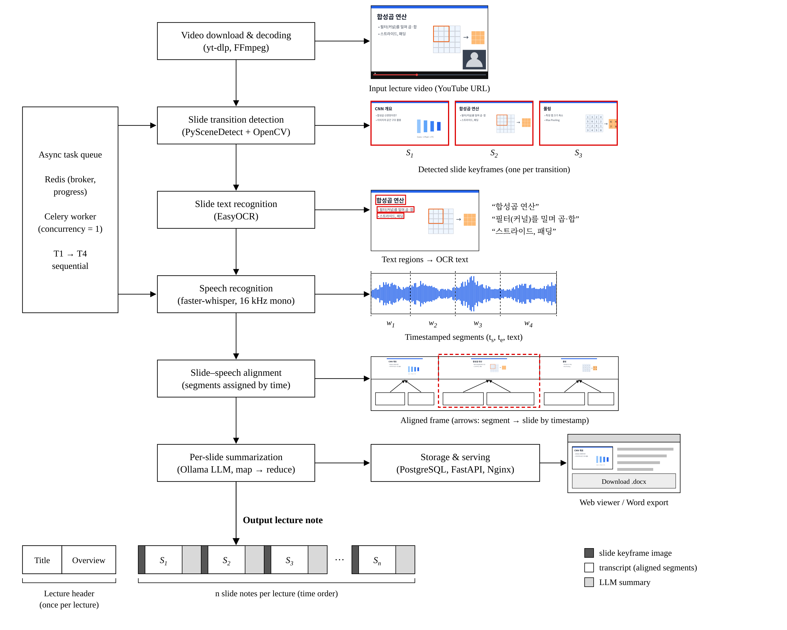
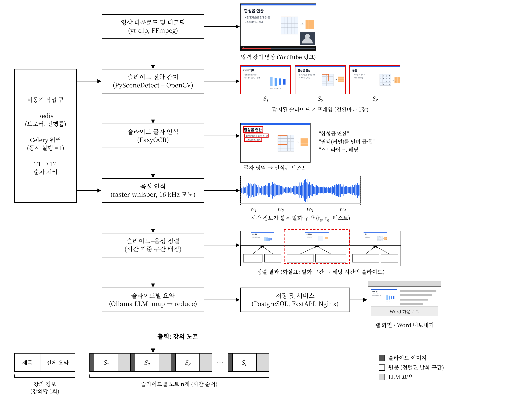

# Lecture Summarizer

*"Half of a lecture lives on the slides. So we read them, too."*

[](https://www.python.org/)
[](https://fastapi.tiangolo.com/)
[](https://www.postgresql.org/)
[](https://redis.io/)
[-000000)](https://ollama.com/)
[](#roadmap)

**Lecture Summarizer** turns a lecture video into **slide-by-slide lecture notes**. It detects every slide in the video, reads the text on it, transcribes what the lecturer said while that slide was on screen, and summarizes each slide with a local LLM. The result is a web viewer and a Word document where every note is **slide image + transcript + summary**.

<table>
<tr><td>
<a href="#the-pitch">The Pitch</a> - <a href="#how-it-works">How it works</a> - <a href="#architecture">Architecture</a> - <a href="#module-contracts">Module contracts</a> - <a href="#quick-look">Quick look</a><br>
<a href="#getting-started">Getting started</a> - <a href="#project-layout">Project layout</a> - <a href="#roadmap">Roadmap</a> - <a href="#contributing">Contributing</a><br>
<a href="#team">Team</a> - <a href="#third-party-open-source">Third-party open source</a> - <a href="#license">License</a> - <a href="#한국어">🇰🇷 한국어</a>
</td></tr>
</table>

---

### The Pitch

Most video summarizers work from the **transcript alone**. In a lecture, though, the most important information is often on the slides: titles, formulas, diagrams, keywords the speaker never says out loud. Lecture Summarizer looks at the screen *and* listens to the audio, and joins the two by time.

Design goals:

- **Slide-aware, not just speech-aware.** Slide transitions define the structure of the notes. Each note is anchored to a real slide, not to an arbitrary text chunk.
- **Local first.** Speech recognition (faster-whisper) and summarization (Ollama) run on your own machine. Lecture content never leaves it.
- **Works without captions.** We transcribe the audio ourselves, so videos with no subtitles and local recordings work too.
- **Never blocks the user.** Processing a lecture takes minutes, so it runs as a background job. The web page only polls for progress.
- **Modules with fixed contracts.** Every stage is a plain function with a fixed input and output type. Stages can be developed, tested, and replaced independently, which keeps merging painless.

### How it works

<p align="center"></p>

1. **Download & decode.** `yt-dlp` fetches the video. `FFmpeg` extracts a 16 kHz mono audio track.
2. **Slide transition detection.** `PySceneDetect` and `OpenCV` find the moments the slide changes and capture one keyframe per slide.
3. **Slide text recognition.** `EasyOCR` reads the text on each keyframe (Korean + English).
4. **Speech recognition.** `faster-whisper` turns the audio into timestamped segments.
5. **Slide–speech alignment.** Each segment is assigned to the slide that was on screen at that time.
6. **Summarization.** `Ollama` summarizes each slide (map), then the whole lecture (reduce).
7. **Storage & serving.** Results are stored in `PostgreSQL`, exposed through `FastAPI`, and served by `Nginx` to the web viewer, which can also export a Word file.

### Architecture

| Layer | Component | Role |
|---|---|---|
| Web server | **Nginx** | Serves the web UI and slide images, reverse-proxies the API |
| API server | **FastAPI** | Register a lecture, report progress, return notes |
| Database | **PostgreSQL** | Stores lectures, slides and notes |
| Task queue | **Redis** + **Celery** | Runs the long pipeline in the background (`concurrency = 1`, so GPU-heavy steps never run at the same time) |
| Media | **FFmpeg**, **yt-dlp** | Download, decode, audio extraction |
| Vision | **PySceneDetect**, **OpenCV**, **EasyOCR** | Slide detection, capture, text recognition |
| Speech | **faster-whisper** | Speech-to-text with timestamps |
| LLM | **Ollama** | Local summarization server |

**Note:** Whisper and the LLM both want the GPU. Running them one after another (a single Celery worker) avoids out-of-memory errors on a single consumer GPU.

### Module contracts

Each stage is a function with a fixed signature. The data types live in `common/schema.py` and are the **only** thing modules share. Database, queue and web code stay outside the modules.

```python
# common/schema.py — the contract between modules (all times are in seconds)

@dataclass
class VideoMeta:            # download()        -> VideoMeta
    video_id: str
    title: str
    video_path: str         # e.g. "data/abc123/video.mp4"
    audio_path: str         # 16 kHz mono wav
    duration: float

@dataclass
class Slide:                # extract_slides()  -> list[Slide]
    no: int                 # 1, 2, 3, ...
    start: float            # slide appears
    end: float              # slide disappears
    image_path: str
    ocr_text: str

@dataclass
class Segment:              # transcribe()      -> list[Segment]
    start: float
    end: float
    text: str

@dataclass
class Note:                 # align(), summarize() -> list[Note]
    slide_no: int           # matches Slide.no
    transcript: str
    summary: str = ""

@dataclass
class LectureResult:        # what the service layer stores and shows
    meta: VideoMeta
    slides: list[Slide]
    notes: list[Note]
    overview: str = ""      # whole-lecture summary
```

| Stage | Function | Input → Output |
|---|---|---|
| Download | `download(url)` | `str` → `VideoMeta` |
| Slides | `extract_slides(video_path)` | `str` → `list[Slide]` |
| Speech | `transcribe(audio_path)` | `str` → `list[Segment]` |
| Alignment | `align(slides, segments)` | `list[Slide], list[Segment]` → `list[Note]` |
| Summary | `summarize(slides, notes)` | `list[Slide], list[Note]` → `(list[Note], str)` |
| Service | `save_result(result)`, `export_docx(result)` | `LectureResult` → DB, web page, `.docx` |

Sample data for every boundary lives in `docs/samples/`, so each stage can be built and tested before the previous one exists.

### Quick look

The whole pipeline is a straight chain of the functions above:

```python
def process_lecture(url: str) -> LectureResult:
    meta   = download(url)                       # VideoMeta
    slides = extract_slides(meta.video_path)     # [Slide(no=1, start=0.0, end=95.3, ...), ...]
    segs   = transcribe(meta.audio_path)         # [Segment(start=0.0, end=4.2, text="오늘은 CNN을..."), ...]
    notes  = align(slides, segs)                 # [Note(slide_no=1, transcript="오늘은 CNN을..."), ...]
    notes, overview = summarize(slides, notes)   # each Note now has a summary
    result = LectureResult(meta, slides, notes, overview)
    save_result(result)                          # stored in PostgreSQL
    return result
```

A Celery task wraps this function and records progress in Redis after each step.

## Getting started

**Requirements**

- Python 3.11
- FFmpeg
- Docker (only to run PostgreSQL, Redis and Nginx locally)
- [Ollama](https://ollama.com/) with a Korean-capable model, e.g. `ollama pull qwen2.5:7b`
- A GPU is recommended. CPU works with smaller models (`whisper small`, 3B LLM), just slower.

**Setup**

```bash
git clone https://github.com/hgh1122/lecture-summarizer.git
cd lecture-summarizer
python -m venv .venv
source .venv/bin/activate          # Windows: .venv\Scripts\activate
pip install -r requirements.txt
```

**Please note:** the repository is being moved to the server architecture described above. Until that lands, `python -m app.main` starts the prototype web UI, and its *"Load sample data"* button works without any model installed.

## Project layout

```
lecture-summarizer/
├─ common/            shared data types (the module contract) — added with the restructure
├─ video/             download, slide detection, OCR
├─ speech/            speech recognition, alignment, summarization
├─ app/               API, web UI, Word export
├─ docs/
│  ├─ images/         figures used in this README
│  ├─ samples/        sample input/output for each module boundary
│  └─ interface.md    detailed data format
├─ data/              downloaded videos and results (not tracked by git)
└─ requirements.txt
```

## Roadmap

- **Stage 1 — Minimum product:** link → slide capture + OCR → transcript → per-slide notes in the web viewer
- **Stage 2 — Core product:** per-slide summaries, duplicate-slide removal, long-video splitting, Word export
- **Stage 3 — Extras:** local file upload, keywords, note search, `.srt` export

## Contributing

- Never push directly to `main`.
- Work on `feature/<name>-<feature>` branches, e.g. `feature/ghhan-slide-detect`.
- One feature per branch, one branch per pull request.
- Pull requests are merged into `main` after the team lead's review.
- Prefix commit messages with the module tag, e.g. `[A] Add slide transition detection`.
- Keep `data/` (videos, audio, results) out of git.
- Changing a type in `common/schema.py` changes everyone's contract. Open a separate PR for it and get the team's agreement first.

## Team

1. **한건희** (A) — video & vision modules (download, slide detection, OCR), task queue, integration
2. **최경호** (B) — speech modules (speech recognition, alignment, summarization)
3. **김준범** (C) — service layer (API, database, web viewer, Word export)

## Third-party open source

This project is built on the following open-source software. Each is used under its own license.

| Project | Used for | License |
|---|---|---|
| [yt-dlp](https://github.com/yt-dlp/yt-dlp) | Video download | Unlicense |
| [FFmpeg](https://ffmpeg.org/) | Decoding, audio extraction | LGPL 2.1+ / GPL |
| [OpenCV](https://github.com/opencv/opencv) | Frame processing | Apache 2.0 |
| [PySceneDetect](https://github.com/Breakthrough/PySceneDetect) | Slide transition detection | BSD 3-Clause |
| [EasyOCR](https://github.com/JaidedAI/EasyOCR) | Slide text recognition | Apache 2.0 |
| [faster-whisper](https://github.com/SYSTRAN/faster-whisper) | Speech recognition | MIT |
| [Ollama](https://github.com/ollama/ollama) | Local LLM server | MIT |
| [PyTorch](https://github.com/pytorch/pytorch) | Deep learning runtime | BSD 3-Clause |
| [PostgreSQL](https://www.postgresql.org/) | Database | PostgreSQL License |
| [Redis](https://github.com/redis/redis) | Queue broker, progress store | RSALv2 / SSPLv1 / AGPLv3 |
| [Celery](https://github.com/celery/celery) | Background task queue | BSD 3-Clause |
| [FastAPI](https://github.com/fastapi/fastapi) | API server | MIT |
| [Nginx](https://nginx.org/) | Web server, reverse proxy | BSD 2-Clause |
| [python-docx](https://github.com/python-openxml/python-docx) | Word export | MIT |

## License

This repository is a university team project. The license will be decided by the team. Third-party components keep their own licenses listed above.

---

<a id="한국어"></a>

# 강의 영상 요약기 (Lecture Summarizer)

*"강의 내용의 절반은 슬라이드에 있다. 그래서 우리는 슬라이드도 읽는다."*

**강의 영상 요약기**는 강의 영상을 **슬라이드별 강의 노트**로 바꿔 주는 프로그램입니다. 영상에서 슬라이드를 하나하나 찾아내 그 위의 글자를 읽고, 슬라이드가 떠 있는 동안 강의자가 한 말을 받아 적은 뒤, 로컬 LLM으로 슬라이드마다 요약합니다. 결과는 웹 화면과 Word 문서로 제공되며, 모든 노트는 **슬라이드 이미지 + 강의 원문 + 요약**으로 구성됩니다.

<table>
<tr><td>
<a href="#소개">소개</a> - <a href="#동작-방식">동작 방식</a> - <a href="#시스템-구성">시스템 구성</a> - <a href="#모듈-계약">모듈 계약</a> - <a href="#한눈에-보기">한눈에 보기</a><br>
<a href="#시작하기">시작하기</a> - <a href="#폴더-구조">폴더 구조</a> - <a href="#개발-로드맵">개발 로드맵</a> - <a href="#협업-규칙">협업 규칙</a><br>
<a href="#팀">팀</a> - <a href="#사용한-오픈소스">사용한 오픈소스</a> - <a href="#라이선스">라이선스</a> - <a href="#lecture-summarizer">🇺🇸 English</a>
</td></tr>
</table>

---

### 소개

대부분의 영상 요약 도구는 **자막 텍스트만** 보고 요약합니다. 하지만 강의에서 가장 중요한 정보는 슬라이드에 있는 경우가 많습니다. 제목, 수식, 도식, 그리고 강의자가 굳이 소리 내어 읽지 않는 핵심어가 그렇습니다. 강의 영상 요약기는 화면을 보는 동시에 소리를 듣고, 두 정보를 시간 기준으로 하나로 묶습니다.

설계 목표:

- **소리만이 아니라 슬라이드까지.** 슬라이드 전환이 노트의 뼈대가 됩니다. 모든 노트는 임의로 자른 텍스트 덩어리가 아니라 실제 슬라이드 한 장에 대응합니다.
- **로컬 우선.** 음성 인식(faster-whisper)과 요약(Ollama)은 내 컴퓨터에서 실행됩니다. 강의 내용이 외부로 나가지 않습니다.
- **자막이 없어도 동작.** 음성을 직접 받아 적기 때문에 자막이 없는 영상이나 직접 녹화한 파일도 처리할 수 있습니다.
- **사용자를 기다리게 하지 않음.** 강의 한 편을 처리하는 데는 몇 분이 걸리므로 백그라운드 작업으로 실행하고, 웹 화면은 진행 상황만 주기적으로 확인합니다.
- **입출력이 고정된 모듈.** 각 단계는 입력과 출력 형식이 정해진 평범한 함수입니다. 단계마다 따로 개발하고 테스트하고 교체할 수 있어서 병합이 수월합니다.

### 동작 방식

<p align="center"></p>

1. **다운로드 및 디코딩.** `yt-dlp`로 영상을 내려받고, `FFmpeg`로 16 kHz 모노 오디오를 추출합니다.
2. **슬라이드 전환 감지.** `PySceneDetect`와 `OpenCV`로 슬라이드가 바뀌는 순간을 찾아 슬라이드마다 대표 화면 한 장을 캡처합니다.
3. **슬라이드 글자 인식.** `EasyOCR`로 대표 화면의 글자(한글·영어)를 읽습니다.
4. **음성 인식.** `faster-whisper`로 음성을 시간 정보가 붙은 발화 구간으로 변환합니다.
5. **슬라이드–음성 정렬.** 각 발화 구간을 그 시각에 화면에 떠 있던 슬라이드에 배정합니다.
6. **요약.** `Ollama`로 슬라이드마다 요약하고(map), 이를 모아 강의 전체를 요약합니다(reduce).
7. **저장 및 서비스.** 결과를 `PostgreSQL`에 저장하고 `FastAPI`로 제공하며, `Nginx`가 웹 화면에 전달합니다. 웹 화면에서는 Word 파일로도 내보낼 수 있습니다.

### 시스템 구성

| 계층 | 구성 요소 | 역할 |
|---|---|---|
| 웹 서버 | **Nginx** | 웹 화면과 슬라이드 이미지 제공, API 요청 전달(리버스 프록시) |
| API 서버 | **FastAPI** | 강의 등록, 진행 상황 조회, 노트 조회 |
| 데이터베이스 | **PostgreSQL** | 강의, 슬라이드, 노트 저장 |
| 작업 큐 | **Redis** + **Celery** | 오래 걸리는 처리를 백그라운드에서 실행 (`concurrency = 1`로 GPU를 쓰는 단계가 동시에 돌지 않게 함) |
| 미디어 | **FFmpeg**, **yt-dlp** | 다운로드, 디코딩, 오디오 추출 |
| 비전 | **PySceneDetect**, **OpenCV**, **EasyOCR** | 슬라이드 감지, 캡처, 글자 인식 |
| 음성 | **faster-whisper** | 시간 정보가 포함된 음성 인식 |
| LLM | **Ollama** | 로컬 요약 서버 |

**참고:** Whisper와 LLM은 모두 GPU를 많이 사용합니다. Celery 워커를 하나만 두고 순서대로 실행하면 일반 소비자용 GPU 한 장에서도 메모리 부족 오류를 피할 수 있습니다.

### 모듈 계약

각 단계는 시그니처가 고정된 함수입니다. 데이터 형식은 `common/schema.py`에 정의되어 있으며, 모듈끼리 공유하는 것은 **이 형식뿐**입니다. 데이터베이스, 큐, 웹 관련 코드는 모듈 바깥에 둡니다.

```python
# common/schema.py — 모듈 간 약속 (시간은 모두 초 단위)

@dataclass
class VideoMeta:            # download()        -> VideoMeta
    video_id: str
    title: str
    video_path: str         # 예: "data/abc123/video.mp4"
    audio_path: str         # 16 kHz 모노 wav
    duration: float

@dataclass
class Slide:                # extract_slides()  -> list[Slide]
    no: int                 # 1, 2, 3, ...
    start: float            # 슬라이드가 나타난 시각
    end: float              # 슬라이드가 사라진 시각
    image_path: str
    ocr_text: str

@dataclass
class Segment:              # transcribe()      -> list[Segment]
    start: float
    end: float
    text: str

@dataclass
class Note:                 # align(), summarize() -> list[Note]
    slide_no: int           # Slide.no와 짝을 이룸
    transcript: str
    summary: str = ""

@dataclass
class LectureResult:        # 서비스 계층이 저장하고 보여 주는 최종 결과
    meta: VideoMeta
    slides: list[Slide]
    notes: list[Note]
    overview: str = ""      # 강의 전체 요약
```

| 단계 | 함수 | 입력 → 출력 |
|---|---|---|
| 다운로드 | `download(url)` | `str` → `VideoMeta` |
| 슬라이드 | `extract_slides(video_path)` | `str` → `list[Slide]` |
| 음성 | `transcribe(audio_path)` | `str` → `list[Segment]` |
| 정렬 | `align(slides, segments)` | `list[Slide], list[Segment]` → `list[Note]` |
| 요약 | `summarize(slides, notes)` | `list[Slide], list[Note]` → `(list[Note], str)` |
| 서비스 | `save_result(result)`, `export_docx(result)` | `LectureResult` → DB, 웹 화면, `.docx` |

모듈 경계마다 샘플 데이터가 `docs/samples/`에 있어서, 앞 단계가 완성되지 않았어도 각 단계를 먼저 만들고 테스트할 수 있습니다.

### 한눈에 보기

전체 파이프라인은 위 함수들을 순서대로 이은 것입니다.

```python
def process_lecture(url: str) -> LectureResult:
    meta   = download(url)                       # VideoMeta
    slides = extract_slides(meta.video_path)     # [Slide(no=1, start=0.0, end=95.3, ...), ...]
    segs   = transcribe(meta.audio_path)         # [Segment(start=0.0, end=4.2, text="오늘은 CNN을..."), ...]
    notes  = align(slides, segs)                 # [Note(slide_no=1, transcript="오늘은 CNN을..."), ...]
    notes, overview = summarize(slides, notes)   # 각 Note에 summary가 채워짐
    result = LectureResult(meta, slides, notes, overview)
    save_result(result)                          # PostgreSQL에 저장
    return result
```

Celery 작업이 이 함수를 감싸고, 단계가 끝날 때마다 Redis에 진행 상황을 기록합니다.

## 시작하기

**필요한 것**

- Python 3.11
- FFmpeg
- Docker (PostgreSQL, Redis, Nginx를 로컬에서 띄울 때만 사용)
- [Ollama](https://ollama.com/)와 한국어를 지원하는 모델 (예: `ollama pull qwen2.5:7b`)
- GPU 권장. GPU가 없으면 작은 모델(`whisper small`, 3B LLM)로 동작하지만 느립니다.

**설치**

```bash
git clone https://github.com/hgh1122/lecture-summarizer.git
cd lecture-summarizer
python -m venv .venv
source .venv/bin/activate          # Windows: .venv\Scripts\activate
pip install -r requirements.txt
```

**참고:** 저장소는 지금 위에서 설명한 서버 구조로 옮겨 가는 중입니다. 그 작업이 끝나기 전까지는 `python -m app.main`으로 시제품 웹 화면을 실행할 수 있으며, *"샘플 데이터로 보기"* 버튼은 모델을 설치하지 않아도 동작합니다.

## 폴더 구조

```
lecture-summarizer/
├─ common/            공통 데이터 형식 (모듈 계약) — 구조 개편 시 추가
├─ video/             다운로드, 슬라이드 감지, 글자 인식
├─ speech/            음성 인식, 정렬, 요약
├─ app/               API, 웹 화면, Word 내보내기
├─ docs/
│  ├─ images/         README에 쓰인 그림
│  ├─ samples/        모듈 경계별 샘플 입출력
│  └─ interface.md    데이터 형식 상세 설명
├─ data/              내려받은 영상과 결과물 (git 관리 대상 아님)
└─ requirements.txt
```

## 개발 로드맵

- **1단계 · 최소 완성:** 링크 입력 → 슬라이드 캡처 + 글자 인식 → 음성 받아쓰기 → 웹 화면에 슬라이드별 노트 표시
- **2단계 · 기본 완성:** 슬라이드별 요약, 중복 슬라이드 제거, 긴 영상 분할 처리, Word 내보내기
- **3단계 · 추가 기능:** 로컬 파일 업로드, 핵심어 추출, 노트 검색, `.srt` 자막 내보내기

## 협업 규칙

- `main` 브랜치에 직접 push하지 않습니다.
- 작업은 `feature/<이름>-<기능>` 브랜치에서 합니다. (예: `feature/ghhan-slide-detect`)
- 기능 하나당 브랜치 하나, 브랜치 하나당 Pull Request 하나를 원칙으로 합니다.
- Pull Request는 팀장 확인 후 `main`에 병합합니다.
- 커밋 메시지 앞에는 모듈 태그를 붙입니다. (예: `[A] 슬라이드 전환 감지 추가`)
- `data/` 폴더(영상, 음성, 결과물)는 git에 올리지 않습니다.
- `common/schema.py`의 형식을 바꾸면 모든 모듈의 약속이 바뀝니다. 반드시 별도 PR로 올리고 팀원 동의를 먼저 받습니다.

## 팀

1. **한건희** (A) — 영상·비전 모듈 (다운로드, 슬라이드 감지, 글자 인식), 작업 큐, 통합
2. **최경호** (B) — 음성 모듈 (음성 인식, 정렬, 요약)
3. **김준범** (C) — 서비스 계층 (API, 데이터베이스, 웹 화면, Word 내보내기)

## 사용한 오픈소스

이 프로젝트는 아래 오픈소스 소프트웨어를 기반으로 만들어졌으며, 각 구성 요소는 고유의 라이선스를 따릅니다.

| 프로젝트 | 용도 | 라이선스 |
|---|---|---|
| [yt-dlp](https://github.com/yt-dlp/yt-dlp) | 영상 다운로드 | Unlicense |
| [FFmpeg](https://ffmpeg.org/) | 디코딩, 오디오 추출 | LGPL 2.1+ / GPL |
| [OpenCV](https://github.com/opencv/opencv) | 프레임 처리 | Apache 2.0 |
| [PySceneDetect](https://github.com/Breakthrough/PySceneDetect) | 슬라이드 전환 감지 | BSD 3-Clause |
| [EasyOCR](https://github.com/JaidedAI/EasyOCR) | 슬라이드 글자 인식 | Apache 2.0 |
| [faster-whisper](https://github.com/SYSTRAN/faster-whisper) | 음성 인식 | MIT |
| [Ollama](https://github.com/ollama/ollama) | 로컬 LLM 서버 | MIT |
| [PyTorch](https://github.com/pytorch/pytorch) | 딥러닝 실행 환경 | BSD 3-Clause |
| [PostgreSQL](https://www.postgresql.org/) | 데이터베이스 | PostgreSQL License |
| [Redis](https://github.com/redis/redis) | 큐 브로커, 진행 상황 저장 | RSALv2 / SSPLv1 / AGPLv3 |
| [Celery](https://github.com/celery/celery) | 백그라운드 작업 큐 | BSD 3-Clause |
| [FastAPI](https://github.com/fastapi/fastapi) | API 서버 | MIT |
| [Nginx](https://nginx.org/) | 웹 서버, 리버스 프록시 | BSD 2-Clause |
| [python-docx](https://github.com/python-openxml/python-docx) | Word 내보내기 | MIT |

## 라이선스

이 저장소는 대학 팀 프로젝트이며, 라이선스는 팀에서 결정할 예정입니다. 외부 구성 요소는 위 표에 적힌 각자의 라이선스를 따릅니다.
